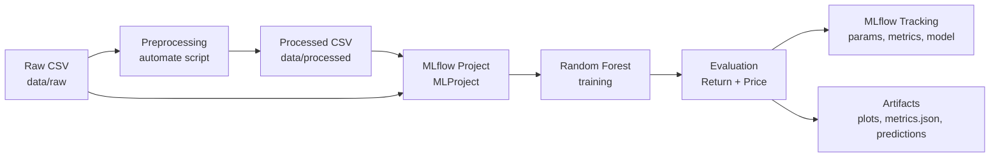

<div align="center">

# 🥇 Gold Return Prediction — End-to-End MLOps

**Predicting gold (XAU/USD) daily returns from historical gold and Swiss franc (CHF/USD) lagged-return features using Random Forest regressor, with automated preprocessing, reproducible MLflow experiments, and a complete GitHub Actions pipeline.**

[](https://www.python.org/)
[](https://scikit-learn.org/)
[](https://mlflow.org/)
[](https://pandas.pydata.org/)
[](https://github.com/features/actions)

</div>

---

## 📖 Overview

This repository provides a clean, self-contained, and reproducible workflow for **gold return prediction**. The target variable `return_gold` is the daily simple return of the gold price in USD. The model learns from the recent history of both gold and Swiss franc returns, which are lagged to form the feature set.

The project integrates three previously separate stages into one end-to-end MLOps repository:

1. **Automated preprocessing** — raw Investing.com datasets are cleaned, aligned, and transformed into a modeling-ready dataset.
2. **Model development** — a `RandomForestRegressor` is trained with a chronological train/test split and evaluated on both the return level and the reconstructed price (USD) level.
3. **CI & experiment tracking** — every training run is tracked in MLflow with explicit manual logging, and the whole flow is orchestrated by GitHub Actions.

> The design goal is **reproducibility and minimal change**: the original preprocessing logic and the original MLflow Project modeling implementation are preserved, with only the necessary path, integration, logging, and artifact adjustments.

---

## ✨ Key Features

- 🧹 **Automated preprocessing** that produces a deterministic, validated dataset from raw CSV files.
- 🌲 **Random Forest regression** on 20 lagged return features (`return_gold_lag_1..10`, `return_chf_lag_1..10`).
- 📈 **Chronological train/test split** (`test_size=0.2`) that respects the time ordering of the data.
- 🧪 **Dual-level evaluation** — metrics at the return level and at the reconstructed gold **price (USD)** level.
- 📝 **Explicit manual MLflow logging** (no autologging) for parameters, metrics, model, and artifacts.
- 🖼️ **Artifact generation** — actual-vs-predicted plots, residual plots, `metrics.json`, and a test-prediction CSV.
- ⚙️ **GitHub Actions automation** — a separate preprocessing workflow plus a full end-to-end pipeline.
- 📦 **Self-contained MLflow Project** that runs independently of the original source directories.

---

## 🏗️ Architecture

```text
Raw Data                 Preprocessing              Processed Dataset
(data/raw/*.csv)  ──▶  (preprocessing script)  ──▶  (data/processed/*.csv)
      │                                                      │
      │                                                      ▼
      │                                            MLflow Project
      │                                    (MLProject/MLProject + conda)
      │                                                      │
      │                                                      ▼
      │                                    Random Forest Training
      │                                                      │
      │                                                      ▼
      │                                          Evaluation (Return + Price)
      │                                                      │
      └──────────────────────────────────────────▶  MLflow Logging & Artifacts
```

A Mermaid view of the same flow:



---

## 📂 Project Structure

```text
gold-return-mlops/
├── .github/
│   └── workflows/
│       ├── preprocessing.yml        # Standalone + reusable preprocessing workflow
│       └── mlops-pipeline.yml       # End-to-end: preprocessing -> train -> log
├── data/
│   ├── raw/                         # Committed raw datasets (Investing.com)
│   │   ├── XAU_USD Historical Data.csv
│   │   └── CHF_USD Historical Data.csv
│   └── processed/                   # Generated modeling dataset (git-ignored)
├── preprocessing/
│   ├── preprocessing.py             # Preprocessing implementation
│   └── requirements.txt             # Preprocessing-only dependencies
├── MLProject/
│   ├── MLproject                    # MLflow Project entry point
│   ├── conda.yaml                   # Conda environment for the MLflow Project
│   ├── modelling.py                 # Training + manual MLflow logging + artifacts
│   └── outputs/                     # Generated run id, metrics, model, artifacts
├── requirements.txt                 # Full local pipeline dependencies
├── .gitignore
└── README.md
```

| Path | Responsibility |
| --- | --- |
| `preprocessing/preprocessing.py` | Loads raw data, cleans it, builds lag features, writes the processed CSV. |
| `MLProject/modelling.py` | Trains the Random Forest, evaluates at return and price levels, logs everything manually to MLflow, writes artifacts. |
| `.github/workflows/preprocessing.yml` | Runs and validates preprocessing; uploads the processed dataset as an artifact. Called by the pipeline. |
| `.github/workflows/mlops-pipeline.yml` | Orchestrates preprocessing → training → MLflow logging, and optionally builds/pushes a Docker image. |

---

## 📊 Dataset and Features

The raw inputs are two Investing.com historical CSVs:

| File | Description | Key columns used |
| --- | --- | --- |
| `data/raw/XAU_USD Historical Data.csv` | Daily gold price in USD | `Date`, `Price` |
| `data/raw/CHF_USD Historical Data.csv` | Daily Swiss franc price in USD | `Date`, `Price` |

**Preprocessing steps** (preserved from the original implementation):

1. Select `Date` and `Price` from each dataset.
2. Convert types (dates via `%m/%d/%Y`, prices with comma removal).
3. Validate, sort, and restrict to `2010-01-01 … 2025-12-31`.
4. Drop rows with missing values in used columns.
5. Remove weekend rows.
6. Inner-join the two datasets on date.
7. Compute simple returns for gold and CHF.
8. Create lag features `lag_1 - lag_10` for both return series.
9. Drop rows with incomplete returns/lags (no imputation).
10. Write the final dataset.

**Processed output** — `data/processed/harga_emas_dan_swiss_franc_preprocessing.csv`:

- **Target:** `return_gold`
- **Features (20):** `return_gold_lag_1..10`, `return_chf_lag_1..10`
- **Key column:** `Date`
- **Rows:** 4,153 (after cleaning/lagging)

The raw files are committed so the pipeline is reproducible from a fresh clone. No normalization is applied because the model is tree-based.

---

## 🚀 Getting Started

### Prerequisites

- Python **3.11**
- `pip`
- (Optional) Conda, if you want to execute the MLflow Project with `--env-manager=conda`
- (Optional) Docker, only for the optional image build/push stage

### 1. Install dependencies

```bash
python -m pip install --upgrade pip
pip install -r requirements.txt
```

### 2. Run preprocessing

```bash
python preprocessing/preprocessing.py
```

This writes `data/processed/harga_emas_dan_swiss_franc_preprocessing.csv`.

### 3. Train the model and log to MLflow

Tracking is served by a local MLflow server. Start it first:

```bash
python -m mlflow server --host 127.0.0.1 --port 5000
```

Then run with the bundled MLflow Project (recommended, reproduces the CI path). Setting
`MLFLOW_TRACKING_URI` ensures the parent `mlflow run` and the training script share the
same store:

```bash
export MLFLOW_TRACKING_URI="http://127.0.0.1:5000/"
mlflow run ./MLProject --env-manager=local \
  -P data_path=data/processed/harga_emas_dan_swiss_franc_preprocessing.csv
```

Or invoke the script directly:

```bash
python MLProject/modelling.py \
  --data-path data/processed/harga_emas_dan_swiss_franc_preprocessing.csv \
  --raw-price-path "data/raw/XAU_USD Historical Data.csv" \
  --output-dir MLProject/outputs
```

### 4. View experiment results

Tracking is stored on the local MLflow server:

- `MLProject/modelling.py` uses `http://127.0.0.1:5000/`.
- Override it with the `MLFLOW_TRACKING_URI` environment variable.

Start the MLflow server (which also serves the UI):

```bash
python -m mlflow server --host 127.0.0.1 --port 5000
```

Then open `http://127.0.0.1:5000`.

### 5. Locate generated outputs

```text
MLProject/outputs/
├── mlflow_run_id.txt              # MLflow run id of the latest training run
├── metrics.json                   # Full run summary (params + metrics)
├── model/                         # Local copy of the logged model artifact
└── artifacts/
    ├── actual_vs_predicted_return.png
    ├── residual_plot_return.png
    ├── actual_vs_predicted_price.png   # only when price evaluation is active
    ├── residual_plot_price.png         # only when price evaluation is active
    └── test_predictions.csv
```

---

## ⚙️ Automated Workflow

Two workflows live in `.github/workflows/`:

### `preprocessing.yml`

- **Triggers:** push to `main` touching `data/raw/**`, `preprocessing/**`, or the workflow file; `workflow_dispatch`; and `workflow_call` (reusable).
- Installs `preprocessing/requirements.txt`, runs the preprocessing script, validates the output schema (22 columns, no missing values), and uploads the processed CSV as the `processed-dataset` artifact.

### `mlops-pipeline.yml`

- **Triggers:** push to `main` touching raw data, preprocessing, the MLflow Project, or workflows; `workflow_dispatch`.
- **Job `preprocessing`:** calls the reusable `preprocessing.yml`.
- **Job `train-and-log`** (runs after preprocessing succeeds):
  1. Downloads the `processed-dataset` artifact into `data/processed/`.
  2. Sets up Miniconda (Python 3.11) and installs MLflow.
  3. Initializes the SQLite tracking store and the experiment.
  4. Runs `mlflow run ./MLProject` with `--env-manager=conda`, passing the processed dataset and raw price paths.
  5. Verifies that `mlflow_run_id.txt`, `metrics.json`, and the return-level artifacts exist.
  6. Downloads the model artifact and uploads everything under `MLProject/outputs` as the `training-outputs` artifact.
  7. **Optional:** builds and pushes a Docker image if `DOCKERHUB_USERNAME` (variable) and `DOCKERHUB_TOKEN` (secret) are configured; otherwise it is skipped.

Because the training job depends on the preprocessing job (`needs: preprocessing`), training always consumes a freshly regenerated dataset and never a stale one. A failure in any stage fails the pipeline clearly.

> Generated outputs are **not committed** back to the repository. They are stored as workflow artifacts (retained for 14 days) and in the ephemeral MLflow tracking store of the runner.

---

## 📈 Model Evaluation and MLflow Tracking

All logging is **explicit and manual** — no `mlflow.autolog()` or `mlflow.sklearn.autolog()` is used.

**Logged parameters**

| Parameter | Description |
| --- | --- |
| `model` | `RandomForestRegressor` |
| `n_estimators` | Number of trees (default `100`) |
| `max_depth` | `None` |
| `random_state` | `42` |
| `test_size` | `0.2` |
| `split_strategy` | `chronological` |
| `target` | `return_gold` |
| `n_features` / `feature_names` | Feature count and names |
| `n_train` / `n_test` | Train/test row counts |

**Logged metrics** (return level, and price level when available)

- `train_MAE`, `train_MSE`, `train_RMSE`, `train_R2`
- `test_MAE`, `test_MSE`, `test_RMSE`, `test_R2`
- `train_price_*` and `test_price_*` (MAE, MSE, RMSE, R²) when price evaluation is active

**Logged model** — `mlflow.sklearn.log_model(model, name="model")`.

**Logged artifacts** — actual-vs-predicted plots, residual plots, `metrics.json`, and `test_predictions.csv`.

### Return-level vs price-level evaluation

- **Return level:** the model predicts `return_gold` directly; metrics are computed on the returns.
- **Price level (USD):** the raw gold price series is validated against `return_gold` (max absolute difference ≤ `1e-6`), then prices are reconstructed with
  `P_t = P_{t-1} × (1 + r_t)`. Metrics and plots are generated for the reconstructed prices.

If the raw price file is missing or the validation fails, the price-level evaluation is **skipped with a clear warning**, and only the return-level results are reported. No price metrics are ever fabricated.

---

## 🔁 Reproducibility and Configuration

| Setting | Value / Source |
| --- | --- |
| Python | 3.11 |
| Data paths | `data/raw/` (input), `data/processed/` (output) |
| Tracking URI (script) | `MLFLOW_TRACKING_URI` or `http://127.0.0.1:5000/` |
| Tracking URI (CI) | `http://127.0.0.1:5000/` |
| Experiment name | `workflow-ci-random-forest-gold` |
| Model artifact path | `model` |

- Paths are resolved by the modelling script relative to the repository, so it does not depend on the current working directory being a specific source folder.
- No credentials or absolute local paths are committed. Optional Docker publishing uses GitHub Actions variables/secrets only.
- The MLflow Project environment is defined in `MLProject/conda.yaml`.

---

## 👤 Author

**Mika Valentino**

- GitHub: [@Valentino812](https://github.com/Valentino812)

---

<div align="center">

*Built with ❤️ for reproducible machine learning.*

</div>
